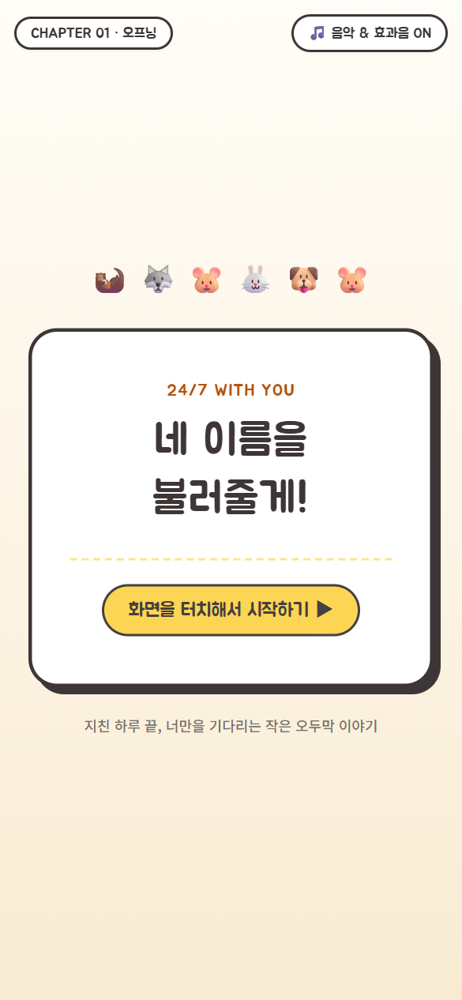
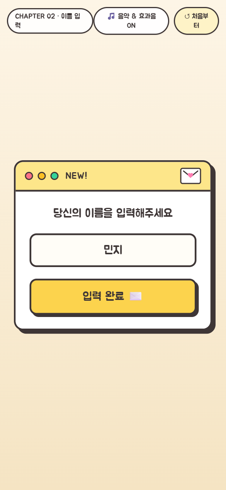
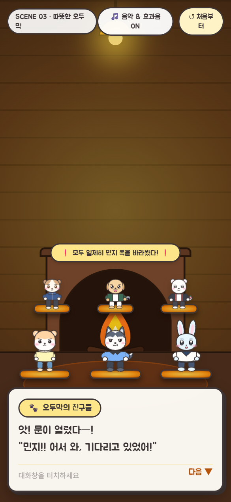
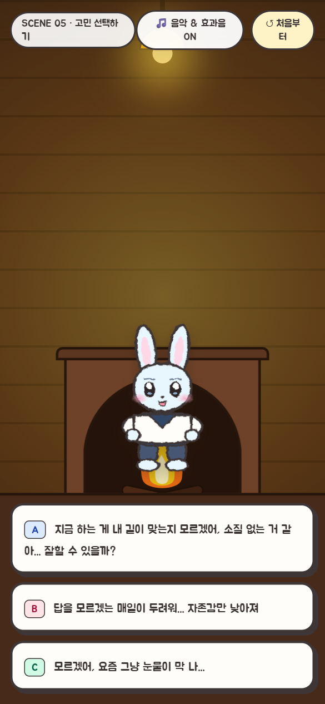
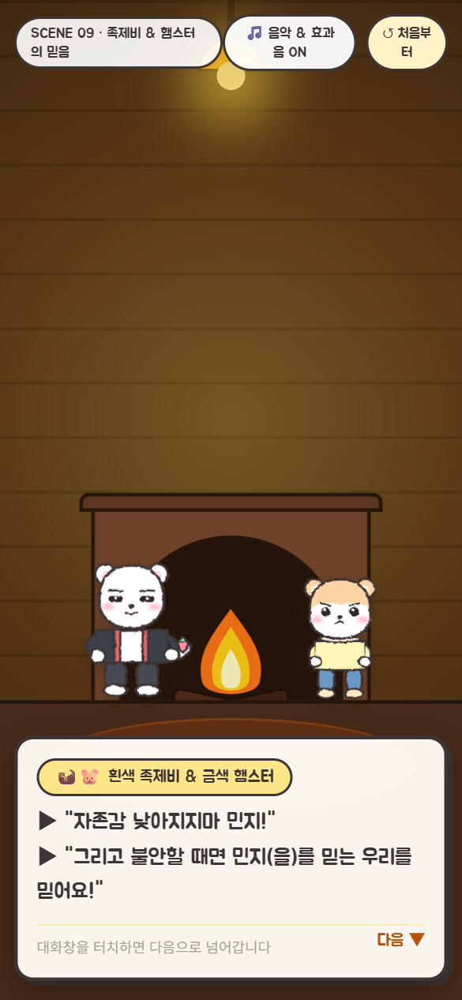
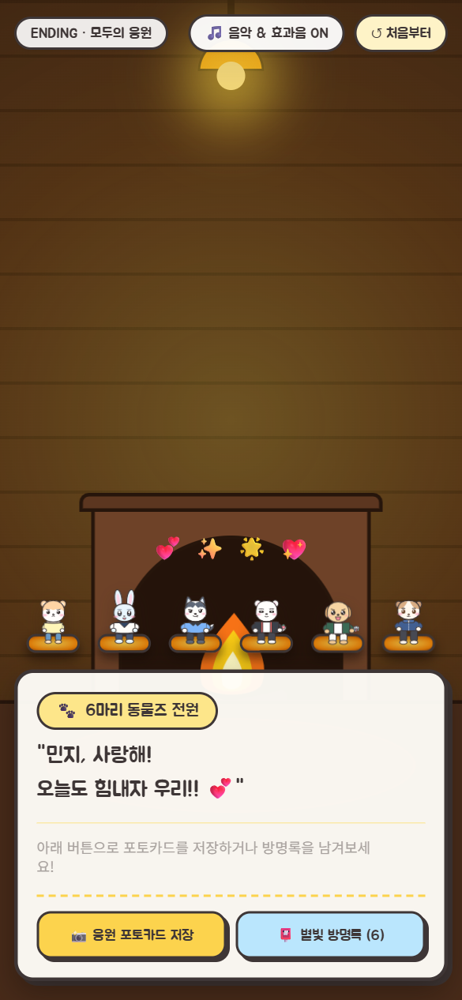
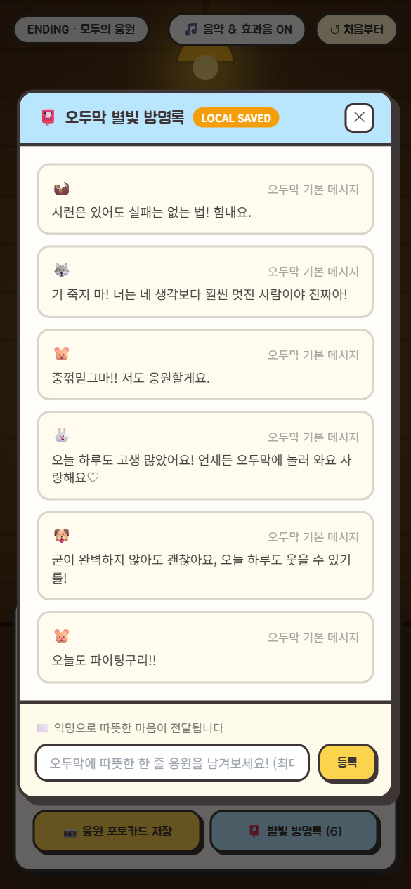
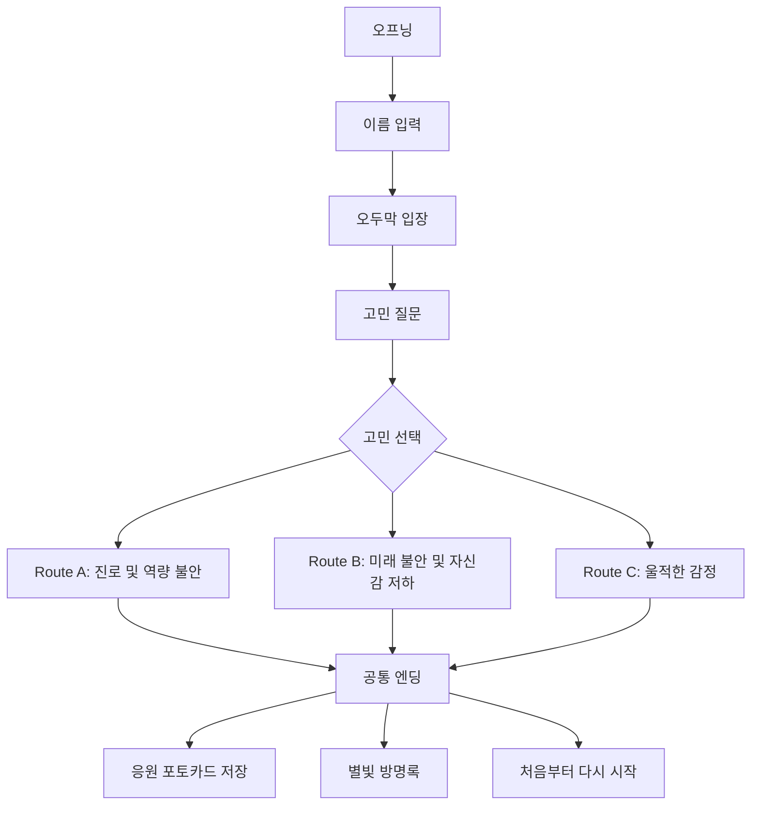
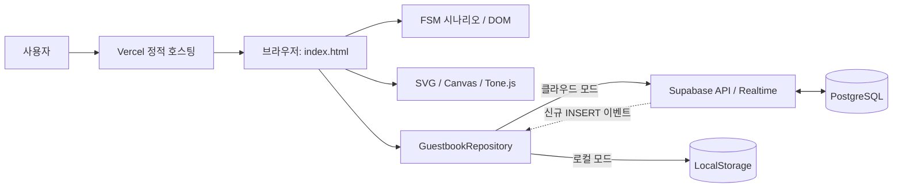

# 네 이름을 불러줄게! | Call Your Name

> 음악의 정서적 메시지를 개인화된 사용자 참여형 콘텐츠로 재해석한 인터랙티브 힐링 비주얼 노벨

[Live Demo](https://call-your-name.vercel.app/) · [기획서](docs/planning.md) · [스토리보드](docs/storyboard.md) · [캐릭터 정의서](docs/characters.md) · [AI 협업 기록](docs/ai-collaboration.md) · [트러블슈팅](docs/troubleshooting.md)

## 1. 프로젝트 소개

아티스트 투어스의 곡 '내 이름을 불러줘'에서 영감을 받아, 진로와 미래에 대한 불안, 자신의 역량에 대한 고민을 경험하는 사용자에게 따뜻한 응원을 전달하고자 기획한 인터랙티브 웹 서비스입니다. 사용자는 자신의 이름을 입력하고 고민 유형을 선택해 동물 캐릭터들과의 분기형 이야기를 경험할 수 있습니다.

| 항목 | 내용 |
| --- | --- |
| 개발 기간 | 2026.11.13 ~ 2026.11.15 |
| 프로젝트 유형 | 개인 프로젝트 |
| 담당 범위 | 서비스 기획, 스토리보드, UI/UX 설계, 캐릭터·의상 콘셉트 정의, AI 협업 개발, 검증 및 배포 |
| 배포 환경 | Vercel |

## 2. 핵심 기능

| 기능 | 구현 내용 |
| --- | --- |
| 개인화 대화 | 사용자 이름을 캐릭터 대사에 동적으로 반영 |
| 분기형 시나리오 | 세 가지 고민 유형에 따라 대화 및 등장 캐릭터 변경 |
| 캐릭터 인터랙션 | 6종의 SVG 캐릭터, CSS 애니메이션 및 장면 전환 |
| 사운드 시스템 | Tone.js 기반 배경음, 효과음, 모닥불 소리 합성 및 ON/OFF |
| 응원 포토카드 | 이름과 고민 유형을 반영한 720 × 920px PNG 생성 및 다운로드 |
| 별빛 방명록 | Supabase 기반 메시지 작성·조회 및 신규 등록 이벤트 구독, 로컬 저장 모드 |

모바일과 데스크톱 화면 크기를 고려한 반응형 UI를 제공합니다.

### 화면 미리보기

| 오프닝 | 이름 입력 | 오두막 입장 | 고민 선택 |
| :---: | :---: | :---: | :---: |
|  |  |  |  |

| 경로별 위로 (B) | 엔딩 | 별빛 방명록 |
| :---: | :---: | :---: |
|  |  |  |

> 테스트용 이름(“민지”)과 로컬 저장 모드로 촬영한 화면입니다.

## 3. 사용자 흐름



총 13개 시나리오 장면과 2개 기능 모달로 구성되며, 선택에 따라 일부 장면으로 분기합니다.

## 4. 기술 스택

| 분류 | 기술 |
| --- | --- |
| Frontend | HTML5, CSS3, Vanilla JavaScript (ES6+), Tailwind CSS |
| Graphics | SVG, CSS Animation, Canvas API, Blob API |
| Audio | Tone.js 14.8.49 |
| Backend as a Service | Supabase, Supabase JS v2, Supabase Realtime |
| Database | PostgreSQL |
| Browser Storage | LocalStorage |
| Deployment | Vercel |
| Typography | Google Fonts (Jua, Noto Sans KR) |

### 기술 선택 근거

| 항목 | 선택 | 근거 |
| --- | --- | --- |
| 운영 비용 | Vercel Hobby, Supabase 무료 플랜, 유료 API 미사용 | 개인 프로젝트를 비용 부담 없이 계속 운영할 수 있도록 **무료로 구현 가능한 범위**를 기능 선정 기준으로 정함 |
| 구현 방식 | 단일 HTML + Vanilla JS, 빌드 과정 없음 | Gemini Canvas가 결과물을 단일 HTML 파일로 만들고, 빌드 없이 Vercel 정적 호스팅에 바로 배포할 수 있음. 로직이 한 파일에 몰리는 한계는 [향후 개선](#11-알려진-결함-및-향후-개선-방향)에 포함 |
| 시나리오 관리 | FSM (`SCENARIO_GRAPH`) | 장면별 화자·대사·캐릭터·다음 상태를 데이터로 분리해, 장면을 고칠 때 렌더링 로직을 건드리지 않도록 함. AI가 함께 제안한 엔딩 수집 요소는 “위로받는 경험”과 맞지 않아 제외 ([의사결정 기록](docs/ai-collaboration.md#4-ai-제안에-대한-의사결정)) |
| 방명록 | Supabase (PostgreSQL + Realtime) | 방명록은 작성자·배지·메시지·작성 시각이 정해진 정형 데이터라 관계형 DB가 적합함. 메시지 길이(1~60자)와 필수값을 DB 제약조건으로 강제하고, 조회·작성만 허용하는 권한을 RLS 정책으로 선언할 수 있음([스키마](supabase/schema.sql)). 표준 SQL 기반이라 다른 PostgreSQL 환경으로 옮기기 쉬움 |
| 사운드 | Tone.js 합성 | 플레이 내내 잔잔한 배경 음악(통기타·모닥불)과 효과음을 넣되, 원곡 음원이나 별도 음원 파일 없이 브라우저에서 합성 |
| 금칙어 필터 | Trie | 검사 시간이 금칙어 개수와 무관하게 입력 길이(M)와 가장 긴 금칙어 길이(L)에만 비례(O(M×L))하도록 설계. 트리에 없는 글자가 나오면 즉시 비교를 멈춤. 현재 금칙어는 8개로, 성능 이점은 사전 확장에 대비한 설계임 |
| 방명록 익명화 | 작성자 이름을 수집하지 않음 | 이름을 불러주는 서비스라 실명을 입력하는 사용자가 많을 수 있음. 고민 상담 콘셉트상 자신의 고민이 드러나는 것을 꺼릴 수 있고, 감성적인 응원 글에 이름이 붙으면 쑥스러울 수 있음. 화면에서만 숨기지 않고 저장·조회 단계에서도 이름을 다루지 않음([TS-05](docs/troubleshooting.md#ts-05-익명-방명록인데-작성자-이름이-저장되고-조회됨)) |

## 5. 시스템 아키텍처

별도의 자체 백엔드 서버 없이 브라우저와 Supabase를 연동하는 구조입니다. UI 렌더링, 시나리오 전환, 사운드 합성 및 이미지 생성은 클라이언트에서 처리합니다.



## 6. 주요 기술 구현

### FSM 기반 시나리오 관리

- `currentStep`으로 현재 장면을 관리하고 `SCENARIO_GRAPH`에 주요 장면별 화자, 대사, 캐릭터 및 다음 상태를 정의합니다.
- `renderFSMNode()`에서 공통 장면 렌더링을 처리하여 시나리오 데이터와 렌더링 로직을 구분합니다.
- 세 가지 분기 경로는 공통 엔딩으로 수렴합니다.

### Trie 기반 금칙어 필터링

- `ProfanityTrie` 클래스를 활용하여 금칙어를 문자 단위 트라이 구조로 저장합니다.
- 작성자 이름과 메시지의 공백을 제거하고 소문자로 변환한 뒤 금칙어 포함 여부를 탐색합니다. 따라서 `시 발`, `F u c k`처럼 띄어 쓴 우회 입력도 탐지합니다.
- 문장의 각 위치에서 트리를 따라 내려가다가, 트리에 없는 글자가 나오면 그 위치의 비교를 즉시 중단합니다.
- 메시지 길이(2~60자)와 등록 간격(5초)을 클라이언트에서 검증하며, 방명록 출력 시 HTML 이스케이프를 적용합니다.

### Repository 패턴 및 실시간 데이터 갱신

- `GuestbookRepository`에 방명록 조회, 등록, 저장 및 이벤트 구독 로직을 캡슐화합니다.
- Supabase Realtime의 `INSERT` 이벤트를 구독하고, 이벤트 발생 시 최신 목록을 다시 조회합니다.
- 클라우드 미사용 모드에서는 LocalStorage에 최대 50개 메시지를 저장합니다.

### 브라우저 기반 멀티미디어 처리

- SVG 캐릭터를 Blob 및 이미지 객체로 변환하고 Canvas API에서 배경 및 문구와 합성합니다.
- 이미지로 분리된 SVG는 페이지의 공용 필터를 참조할 수 없으므로, 변환 전에 공용 `<defs>`를 각 SVG에 포함합니다. 이 처리가 없으면 iPhone Safari에서 캐릭터가 사라집니다. ([TS-04](docs/troubleshooting.md#ts-04-iphone-safari에서-포토카드-캐릭터가-표시되지-않음))
- Tone.js의 신시사이저와 노이즈 합성을 활용하여 별도의 음원 파일 없이 사운드를 생성합니다.

## 7. 데이터베이스 구조

방명록 데이터는 Supabase PostgreSQL의 `guestbook` 테이블을 사용합니다.

| 컬럼 | 역할 |
| --- | --- |
| `id` | 메시지 식별자 |
| `author` | 작성자 표시명. 이름을 수집하지 않으므로 모든 글이 기본값 `'친구'`로 저장됨 |
| `badge` | 캐릭터 배지 |
| `message` | 응원 메시지 |
| `created_at` | 작성 시각 |

클라우드 모드에서는 최근 작성 순서 기준 최대 30개의 메시지를 조회합니다.

| 구분 | 설정 |
| --- | --- |
| 제약조건 | `message` 1~60자(`CHECK`), 모든 컬럼 `NOT NULL`, `author` 기본값 `'친구'`, `badge` 기본값 `'✉️'` |
| RLS 정책 | 비로그인·로그인 사용자에게 `SELECT`, `INSERT`만 허용 |
| 권한 | `UPDATE`, `DELETE` 권한을 부여하지 않아 작성된 글의 수정·삭제 차단 |

전체 설정은 [supabase/schema.sql](supabase/schema.sql)에 있습니다.

## 8. 로컬 실행 방법

현재 소스는 HTML, CSS, JavaScript를 단일 HTML 파일에 포함한 구조이며, 별도의 npm 패키지 설치 또는 빌드 과정이 필요하지 않습니다.

### 실행

1. 저장소를 다운로드하고 `index.html`이 있는 디렉터리로 이동합니다.
2. Python 3이 설치되어 있다면 다음 명령으로 로컬 HTTP 서버를 실행합니다.

```bash
python -m http.server 8000 --bind 127.0.0.1
```

3. 브라우저에서 `http://127.0.0.1:8000`에 접속합니다.

외부 CDN에서 라이브러리와 폰트를 불러오므로 인터넷 연결이 필요합니다.

### 방명록 설정

공개 서비스의 데이터베이스에 영향을 주지 않도록 로컬 실행 시에는 `index.html`의 `SUPABASE_CONFIG` 값을 비워 로컬 저장 모드로 실행할 수 있습니다.

```javascript
const SUPABASE_CONFIG = {
  url: "",
  anonKey: ""
};
```

별도의 Supabase 프로젝트를 연동하려면 다음 설정이 필요합니다.

- `SUPABASE_CONFIG.url`에 프로젝트 기본 URL (`https://<project-ref>.supabase.co`) 입력
- `SUPABASE_CONFIG.anonKey`에 publishable key 또는 legacy anon key 입력 (service_role 및 secret key 사용 금지)
- SQL Editor에서 [supabase/schema.sql](supabase/schema.sql)을 실행해 `guestbook` 테이블, RLS 정책, 권한 설정
- `guestbook` 테이블의 Realtime 변경 이벤트 활성화

## 9. 개발 방식 및 AI 활용

| 단계 | 직접 수행 | AI 활용 |
| --- | --- | --- |
| 기획 및 화면 설계 | 서비스 기획, 스토리보드, 화면 구성 및 사용자 흐름 설계 | — |
| 캐릭터 및 의상 디자인 | 외형과 의상의 세부 특징을 문서로 정의 | Gemini Canvas를 활용한 SVG 그래픽 생성 |
| 개발 | 구현 요구사항 전달, 실제 동작 확인 및 반복 개선 | Gemini Canvas 기반 바이브 코딩 |
| 검증 및 배포 | 프로그램 직접 실행을 통한 반복 검증, Vercel 배포 및 팬 사이트 공유 | — |
| 출시 후 유지보수 | 실기기 결함 확인, 수정 방향 결정, 최종 검증 | Claude Code를 활용한 원인 분석, 재현 테스트, 수정 |

AI를 활용해 그래픽과 코드를 생성하고, 기획 의도에 부합하는지 직접 실행하여 확인하는 반복적 개발 방식을 적용했습니다.

- **AI 제안을 선별해 채택**: 엔딩 수집·히든 엔딩 제안은 사용자에게 숙제처럼 느껴질 수 있어 반려하고, FSM 구조만 채택했습니다.
- **윤리적 판단으로 반려**: 캐릭터별 목소리 합성 제안은, 당사자 동의 없이 실존 인물의 목소리를 모방하게 된다는 이유로 채택하지 않았습니다.
- **AI 오류를 직접 발견**: 존재하지 않는 CSS 클래스로 인한 캐릭터 겹침, 방명록 저장 실패 진단 오류, 기본 메시지가 사라지는 로직 등을 실행 화면과 실사용으로 찾아냈습니다.

실제 프롬프트, 의사결정, AI 오류 사례는 [AI 협업 기록](docs/ai-collaboration.md)에 정리했습니다.

## 10. 구현 결과 및 검증

- 3일간 기획부터 배포까지 제품 구현의 전 과정을 수행했습니다.
- 6종 캐릭터, 13개 시나리오 장면, 3개 분기 경로 및 방명록 기능을 구현했습니다.
- 개발자가 직접 프로그램을 반복 실행하며 기능을 수동 검증했습니다.
- 팬 사이트에 서비스를 공유한 후 실제 사용자 2명이 작성한 방명록 메시지가 정상적으로 저장됨을 확인했습니다.
- 실제 사용자로부터 서비스 이용 후 정서적 위로를 받았다는 정성적 피드백을 확보했습니다.
  > “사이분이 만들어주신 컨텐츠도 요즘 힘들었는데 위로가됐어요☺️ 고생하셨어요🫶” — 팬 커뮤니티 댓글 (2026.11.15, 작성자 비공개)

위 결과는 수동 검증 및 실제 이용 사례에 기반합니다. 전체 기능의 정상 동작, 자동화 테스트 통과, 성능 또는 사용성에 대한 정량적 검증을 의미하지 않습니다.

## 11. 알려진 결함 및 향후 개선 방향

| 현재 한계 | 개선 방향 |
| --- | --- |
| 단일 HTML 파일에 구현 로직 집중 | UI, 시나리오, 데이터 접근 로직 모듈 분리 |
| 클라이언트 측 금칙어 및 등록 간격 검증 | 서버 측 콘텐츠 검증 및 Rate Limiting 검토 |
| 클라우드 장애 시 자동 저장 전환 및 복구 미보장 | 네트워크 오류 및 데이터 복구 처리 개선 |
| 제한된 사용자 검증 범위 | 추가 사용자 피드백 및 사용성 테스트 |
| 특수문자·숫자를 끼워 넣은 금칙어 우회 입력(예: `시1발`)은 탐지하지 못함 | 정규화 규칙 확장 검토 |
| 포토카드를 저장만 할 수 있고 바로 공유할 수 없음 | Web Share API를 활용한 모바일 공유 기능 |
| 방명록 작성자가 본인 글을 직접 삭제할 수 없음 | 작성자 기기에 삭제 코드를 발급하는 방식 검토 |

위 개선 방향은 향후 계획이며 완료된 기능이 아닙니다.

해결된 결함: iPhone Safari에서 포토카드 캐릭터가 표시되지 않던 문제 ([TS-04](docs/troubleshooting.md#ts-04-iphone-safari에서-포토카드-캐릭터가-표시되지-않음), PR #1). 그 밖의 해결 과정은 [트러블슈팅](docs/troubleshooting.md)에 정리했습니다.

## 12. 콘텐츠 안내

본 프로젝트는 해당 아티스트의 음악에서 영감을 받아 제작한 비공식·비영리 팬메이드 프로젝트이며, 아티스트 및 소속사와 공식적인 관련이 없습니다. 원본 음원, 가사 및 뮤직비디오 이미지를 직접 삽입하지 않고 별도의 캐릭터 그래픽과 시나리오, 브라우저 기반 합성 사운드를 활용했습니다.

## 13. 라이선스

현재 별도의 오픈소스 라이선스를 부여하지 않았습니다. 소스 코드의 사용·수정·재배포에 대한 별도 허용 범위는 추후 결정할 예정입니다. 제3자 라이브러리에는 각 라이브러리의 라이선스가 적용됩니다.
