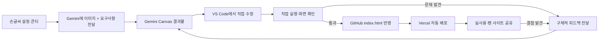

# AI 협업 기록

이 문서는 「네 이름을 불러줄게!」를 만들면서 AI를 어떻게 활용했는지, 그리고 AI의 제안과 결과물을 어떤 기준으로 채택·반려·수정했는지 기록합니다.

- 근거 자료: Gemini 대화 기록, Git 커밋 이력, 소스 코드
- 프롬프트는 실제 입력한 문장을 그대로 옮겼습니다.

---

## 1. 역할 분담

| 구분 | 직접 수행 | AI 활용 |
| --- | --- | --- |
| 기획 | 서비스 콘셉트, 고민 유형 3가지, 13개 장면 콘티(손그림), **모든 대사 작성(AI 미사용)** | — |
| 캐릭터 | 6종 캐릭터의 설정·외형·의상 정의(손글씨) | Gemini Canvas로 SVG 캐릭터 생성 |
| 개발 | 요구사항 전달, VS Code에서 코드 직접 수정, 실행 결과 검증, 기능 범위 결정 | Gemini Canvas로 코드 생성(바이브 코딩) |
| 출시 후 유지보수 | 결함 확인(실기기), 수정 방향 결정, 최종 검증 | Claude Code로 원인 분석, 재현 테스트, 수정 |

## 2. 작업 흐름

AI가 만든 코드를 그대로 쓰지 않고, VS Code에서 열어 일부를 직접 고치며 함께 작업했습니다.

---

## 3. 실제 사용한 프롬프트

### P1. 손글씨 설정으로 캐릭터 만들기

- **입력**: 6종 캐릭터의 설정과 외형을 손글씨로 정리한 메모 사진
- **프롬프트**
  > 내가 구상한 6마리 동물 캐릭터의 설정과 외형 특징이야, 사진 속 내용을 바탕으로 캐릭터 svg/css 만들어줄 수 있어? 그림체는 최대한 복실복실 + 귀여움 + 특징이 뚜렷하게 드러남 으로 부탁해
- **포인트**: 외형 정의는 직접 하고, AI에는 **그림체 기준 3가지**(복실복실, 귀여움, 특징이 뚜렷함)만 지정했습니다.
- **결과**: 얼굴과 몸을 1:1 비율로 맞추고, SVG 필터(`feTurbulence` + `feDisplacementMap`)로 크레용 질감을 낸 캐릭터 6종

### P2. 콘티로 게임 만들기

- **입력**: 13개 장면 콘티 스케치와 연출 메모(손그림)
- **프롬프트**
  > 저 6명의 캐릭터가 등장하는 간단한 게임을 제작하고 싶어, 화면 구성은 다음과 같이 제작하고 싶은데 네가 저 6종 캐릭터를 기반으로 한 간단한 게임 제작해줄 수 있어?
- **포인트**: 장면 구성, 분기(A·B·C), 대사는 콘티에서 이미 정해 두고 구현만 맡겼습니다.

### P3. 실행 화면을 보고 구체적으로 피드백하기

- **입력**: 오프닝 화면과 오두막 장면 스크린샷
- **프롬프트**
  > 첫번째 사진에 WARM CABIN ~ 저 문구가 좀 더 게임 제목이랑 관련 있는 문구면 좋겠어.. Call your name이라던가, 아님 24/7 with you?? 그런 느낌으로, 그리고 두번째 사진에 배치가 이상해 캐릭터들끼리 서로 가리면 안되고, 실제로 존재하는 캐릭터들이 앉아 있는 느낌이면 좋겠어. 그리고 플레이 하는 내내 효과음 + 잔잔한 모닥불이나 통기타? 배경 음악이 흘러나왔으면 좋겠어
- **포인트**: 화면마다 **무엇이 문제이고 어떤 상태가 되어야 하는지**를 함께 전달했습니다. 이 피드백으로 캐릭터 배치 결함([TS-01](./troubleshooting.md#ts-01-캐릭터가-거대해지고-서로-겹침))이 드러났습니다.

### P4. 제약 조건 걸기

- **프롬프트**
  > 무료로 구현 가능한 범위에서만 소개해봐
- **포인트**: 개인 프로젝트로 운영 비용이 생기지 않도록 **비용 0원**을 기능 선정 기준으로 정했습니다. 유료 API와 유료 서버는 처음부터 범위에서 뺐습니다.

### P5. 평가자 관점으로 우선순위 묻기

- **프롬프트**
  > 네가 ICT 기업 면접관이자 포트폴리오 첨삭 멘토라면 어떤 기능을 넣는 걸 우선적으로 추천할 것 같은지 TOP3만 타당한 이유와 함께 제시해봐
- **포인트**: AI에 역할을 부여해 기능 후보의 우선순위를 받았습니다. 다만 그 답을 그대로 따르지 않고 다시 검토했습니다(아래 4장).

---

## 4. AI 제안에 대한 의사결정

| AI 제안 | 결정 | 근거 |
| --- | --- | --- |
| FSM 기반 시나리오 엔진 + **엔딩 수집률(1/3) 표시, 3가지 엔딩을 모두 보면 해금되는 히든 엔딩** (TOP3 중 1순위) | **구조만 채택, 수집 요소는 반려** | “너무 3가지 엔딩을 다 해보라고 강요하는 것 같다”고 판단했습니다. 이 서비스의 본질은 고민 하나를 털어놓고 위로받는 경험인데, 수집 요소는 숙제처럼 느껴질 수 있습니다. FSM은 시나리오 데이터와 렌더링 로직을 분리하는 내부 구조로만 사용했습니다. |
| Canvas 기반 응원 포토카드 생성 (TOP3 중 2순위) | **채택** | 사용자가 위로받은 경험을 이미지로 간직할 수 있습니다. 함께 제안된 Web Share API 공유 기능은 향후 개발 항목으로 남겼습니다. |
| 실시간 방명록 (TOP3에 없음) | **직접 제안해 채택** | “DB, 네트워크가 중요하니까 방명록도 괜찮을 것 같다”고 판단했습니다. 클라이언트와 서버 간 데이터 흐름, DB 스키마 설계, 실시간 동기화를 다룰 수 있습니다. |
| `requestAnimationFrame` 기반 타이핑 엔진 + **캐릭터별 목소리 합성** (TOP3 중 3순위) | **반려** | 팬 사이트에 공유하는 팬메이드 프로젝트라, 캐릭터에 목소리를 입히면 캐릭터가 연상시키는 실존 인물의 목소리를 닮게 만들어야 합니다. 당사자 동의 없이 실존 인물의 목소리를 모방하는 것은 윤리적으로 부적절하다고 판단했습니다. |

---

## 5. AI가 틀렸던 사례와 직접 잡아낸 방법

| # | AI의 오류 | 어떻게 발견했나 | 결과 |
| --- | --- | --- | --- |
| E1 | Tailwind에 없는 크기 클래스(`w-25`, `w-26`, `w-30`)를 생성해, 흰색 족제비가 거대해지고 캐릭터끼리 겹침 | 실행 화면을 직접 보고 “배치가 이상하다, 서로 가리면 안 된다”고 피드백 | 표준 클래스(`w-20 h-20 sm:w-24 sm:h-24`)로 교체 · [TS-01](./troubleshooting.md#ts-01-캐릭터가-거대해지고-서로-겹침) |
| E2 | 방명록 저장 실패를 테이블·RLS 문제로 진단하고 테이블 재생성 SQL을 제시했지만, 실행 후에도 같은 오류가 반복됨. 실제 원인은 Supabase URL 설정 | 안내대로 조치한 뒤 실제로 다시 등록해 보고, 같은 오류가 반복된다고 되물음 | Supabase URL을 기본 주소로 고치고, 오류 원인이 화면에 보이도록 수정 · [TS-02](./troubleshooting.md#ts-02-방명록-저장-실패) |
| E3 | 방명록에 글이 하나라도 등록되면 기본 응원 메시지가 모두 사라지는 로직 | 실제로 글을 등록해 보고 “전부 다 누적됐으면 좋겠다”고 요구 | 기본 메시지를 항상 함께 표시하도록 수정 · [TS-03](./troubleshooting.md#ts-03-방명록에-글이-등록되면-기본-메시지가-사라짐) |
| E4 | 닉네임 숨김을 요청하자 “이 줄을 지우고, 이 부분만 남기라”는 식의 부분 지시만 제공 | 그대로는 적용할 수 없다고 판단하고 “바로 복붙 가능한 형태로 알려달라”고 재요청 | 닉네임 숨김 반영 (`4fc2b07`) |
| E5 | 포토카드용 SVG 변환 코드가 페이지 공용 필터를 참조한 채로 이미지화되어, iPhone Safari에서 캐릭터가 사라짐 | 배포 후 iPhone에서 직접 포토카드를 저장해 보고 발견 | 출시 후 Claude Code로 원인을 분석하고 수정 · [TS-04](./troubleshooting.md#ts-04-iphone-safari에서-포토카드-캐릭터가-표시되지-않음) |
| E6 | 캐릭터 일부만 수정해 달라고 요청했는데, 수정하지 않은 부분까지 훼손됨. 카드 사이에 중복 조각이 끼어 들어가고, 1·2번만 고쳐 달라는 요청 뒤 1번이 사라지고 3번이 2번과 합쳐짐 | 수정 결과를 받을 때마다 요청한 부분뿐 아니라 6종 전체를 다시 확인 | 훼손된 부분을 짚어 복구를 재요청 |

### 사례에서 얻은 작업 원칙

- **AI가 만든 결과는 화면과 실사용으로 검증한다.** E1·E3·E5·E6는 코드만 봐서는 드러나지 않았고, 직접 실행하거나 실제로 써 봐야 발견됐습니다.
- **AI의 진단은 가설로 다룬다.** E2에서 첫 진단대로 조치했지만 해결되지 않았습니다. 조치 후 결과를 다시 확인하는 과정이 필요했습니다.
- **오류 메시지는 원인을 드러내야 한다.** E2에서 “서버 저장 중 오류”라는 뭉뚱그린 메시지 때문에 원인을 찾기가 어려웠습니다.
- **수정 지시는 적용할 수 있는 형태로 받는다.** E4처럼 부분 지시는 작업 환경에 따라 적용하기 어렵습니다.
- **부분 수정 뒤에는 전체를 다시 확인한다.** E6처럼 AI는 요청하지 않은 부분까지 바꿀 수 있습니다.

