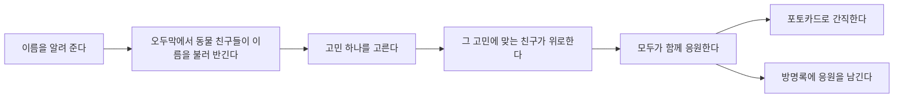

# 기획서

## 1. 개요

| 항목 | 내용 |
| --- | --- |
| 서비스명 | 네 이름을 불러줄게! (Call Your Name) |
| 한 줄 소개 | 지친 하루 끝, 내 이름을 불러 주는 동물 친구들에게 고민을 털어놓고 위로받는 인터랙티브 힐링 비주얼 노벨 |
| 형태 | 모바일·데스크톱 반응형 웹 |
| 기간 | 2026.11.13 ~ 2026.11.15 (3일) |
| 유형 | 개인 프로젝트, 비공식·비영리 팬메이드 |
| 배포 | Vercel, 팬 사이트 커뮤니티에 공유 |

## 2. 배경

아티스트 투어스의 곡 ‘내 이름을 불러줘’에서 영감을 받았습니다.

- **곡에서 읽은 메시지**: 답을 모른 채 하루하루가 흘러가고 어떤 선택도 확신할 수 없지만, 서로를 믿고 나아가겠다는 마음. 그리고 그저 내 이름을 불러 달라는 바람
- **얻은 통찰**: 나만이 아니라 누구나 자신의 선택을 온전히 믿지 못한 채 불안한 하루를 살아간다. 그럴 때 나를 믿어 줄 것 같은 누군가가 **내 이름을 불러 주는 것만으로도** 큰 정서적 지지와 위로가 될 수 있다.
- **핵심 콘셉트**: 사용자의 이름을 불러 주며 위로를 건네는 경험

> 원곡의 가사는 인용하지 않고, 곡에서 받은 인상을 풀어 썼습니다.

## 3. 타깃 사용자

| 구분 | 대상 | 근거 |
| --- | --- | --- |
| 1차 타깃 | 투어스의 팬 | 좋아하는 아이돌의 노래를 응용한 서비스이므로, 이 콘셉트를 가장 반가워할 사용자층 |
| 2차 타깃 | 불안하고 방황하는 20~30대 | “20~30대는 누구나 불안하고, 자신의 선택이 맞는지 모른 채 방황하는 시기”라는 이야기를 주변과 여러 매체에서 많이 접함. 서비스 속 대사가 이들에게 조금이라도 위로가 되기를 바람 |

- 배포 채널: 해당 아티스트의 팬 커뮤니티
- 진심이 전해지도록 **모든 대사는 AI의 도움 없이 직접 작성**했습니다.

## 4. 핵심 경험

| 설계 요소 | 내용 |
| --- | --- |
| 이름 부르기 | 입력한 이름을 모든 대사에 넣어, 캐릭터가 사용자를 직접 부르도록 함 |
| 고민 유형 3가지 | A. 진로 및 역량 불안 / B. 미래 불안 및 자신감 저하 / C. 울적한 감정 |
| 경로별 위로 | 고민마다 다른 캐릭터가 다른 방식으로 위로하고, 모두 같은 엔딩에서 함께 응원 |
| 공간 | 모닥불 난로가 있는 노란 조명의 따뜻한 오두막 |

### 설계 근거

| 결정 | 근거 |
| --- | --- |
| 고민 유형을 3가지로 구분 | 방황하는 청춘의 대표적인 고민이 진로·역량, 미래와 자존감, 이유 모를 울적함이라고 판단. 실제로 주변 친구들과 진지한 이야기를 나누면 대부분 이 세 가지 이야기가 나옴 |
| 비주얼 노벨 형식 | 가장 중요한 것은 위로의 메시지를 끝까지 전하는 것. 줄글로 전하면 지루해서 제대로 읽지 않을 수 있어, 몰입도와 집중도를 높이는 형식을 선택 |
| 동물 캐릭터 | 정서적으로 지친 사람에게 더 친근하게 다가가기 위해. 사람이나 로봇보다 귀엽고 복실한, 곡선 위주의 동물 이미지가 심리적 경계심을 낮춤 |
| 캐릭터 의상 | 1차 타깃인 팬층이 알아보고 반가워하도록, 곡의 뮤직비디오 의상에서 모티프를 얻음. 팬 유입과 공유 확산을 기대 |

## 5. 기능 범위

### 포함한 기능

| 기능 | 목적 |
| --- | --- |
| 이름 입력과 개인화 대사 | 핵심 경험인 “이름 불러 주기” |
| 3가지 고민 분기와 공통 엔딩 | 사용자가 고른 고민에 맞는 위로 |
| 사운드 (배경 음악, 모닥불 소리, 효과음) | 플레이 내내 잔잔하고 따뜻한 분위기 |
| 응원 포토카드 | 위로받은 경험을 이미지로 간직 |
| 별빛 방명록 | 다른 방문자와 응원을 주고받음. DB·네트워크를 다루는 기능 |

### 제외한 기능

| 기능 | 제외 이유 |
| --- | --- |
| 엔딩 수집률, 히든 엔딩 | 3가지 엔딩을 모두 보도록 강요하는 숙제처럼 느껴질 수 있어, 위로받으러 온 경험과 맞지 않음 |
| 캐릭터별 목소리 합성 | 캐릭터가 연상시키는 실존 인물의 목소리를 당사자 동의 없이 모방하게 되어 윤리적으로 부적절 |
| 유료 API, 유료 서버 | 개인 프로젝트를 비용 없이 계속 운영하기 위해 무료로 구현 가능한 범위로 한정 |
| 포토카드 바로 공유 (Web Share API) | 향후 개발 항목 |

## 6. 운영 원칙

| 원칙 | 적용 |
| --- | --- |
| 원작 존중 | 원본 음원, 가사, 뮤직비디오 이미지를 쓰지 않고 자체 캐릭터와 합성 사운드만 사용. 비공식 팬메이드임을 고지 |
| 개인정보 최소 수집 | 방명록 작성자 이름을 수집하지 않음 ([TS-05](./troubleshooting.md#ts-05-익명-방명록인데-작성자-이름이-저장되고-조회됨)) |
| 따뜻한 공간 유지 | 금칙어 필터, 등록 간격 제한(5초), 메시지 길이 제한(2~60자) |

## 7. 일정

| 일차 | 작업 |
| --- | --- |
| 1일차 | 서비스 콘셉트 설정과 구체화, 캐릭터 설정·의상 디자인(손글씨) |
| 2일차 | AI로 캐릭터 그래픽 제작(원하는 그림체가 나오지 않아 조정에 시간 소요), 화면 설계(손그림 스토리보드) |
| 3일차 | 개발, 배포 |

## 8. 성공 기준과 결과

| 기준 | 목표 | 결과 | 평가 |
| --- | --- | --- | --- |
| 사용자 확보 (정량) | 사용자 5~10명 이상 | 방명록 작성 기준 실제 사용자 2명 | **미달** |
| 정서적 위로 (정성) | 사용자가 실제로 위로를 받음 | 팬 커뮤니티에서 “위로가 됐다”는 반응 확인 | 달성 |

> “사이분이 만들어주신 컨텐츠도 요즘 힘들었는데 위로가됐어요☺️ 고생하셨어요🫶”
> — 팬 커뮤니티 댓글 (2026.11.15, 작성자 비공개)
