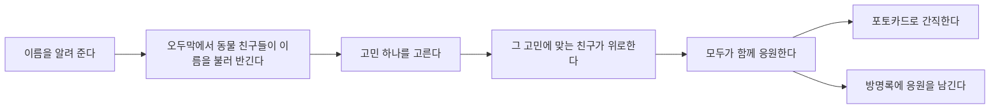

# 기획서

## 1. 개요

| 항목 | 내용 |
| --- | --- |
| 서비스명 | 네 이름을 불러줄게! (Call Your Name) |
| 한 줄 소개 | 지친 하루 끝, 내 이름을 불러 주는 동물 친구들에게 고민을 털어놓고 위로받는 인터랙티브 힐링 비주얼 노벨 |
| 형태 | 모바일·데스크톱 반응형 웹 |
| 기간 | 2026.11.13 ~ 2026.11.15 (3일) |
| 유형 | 개인 프로젝트, 비공식·비영리 팬메이드 |
| 배포 | Vercel, 팬 사이트 커뮤니티에 공유 |

## 2. 배경

아티스트 투어스의 곡 ‘내 이름을 불러줘’에서 영감을 받았습니다. 진로와 미래에 대한 불안, 자신의 역량에 대한 고민을 겪는 사람에게 따뜻한 응원을 전하는 것이 목표입니다.

> ⚠️ 확인 필요: 이 곡에서 **“이름을 불러 준다”**를 핵심 경험으로 잡은 이유를 한두 문장으로 알려주세요.

## 3. 타깃 사용자

- 진로와 미래에 대한 불안, 자신의 역량에 대한 고민을 겪는 사람
- 배포 채널: 해당 아티스트의 팬 커뮤니티

> ⚠️ 확인 필요: 주 타깃을 어떻게 정의하셨나요? (예: 팬덤 중 학생·취업 준비생 등) 그렇게 판단한 근거도 함께 알려주세요.

## 4. 핵심 경험

| 설계 요소 | 내용 |
| --- | --- |
| 이름 부르기 | 입력한 이름을 모든 대사에 넣어, 캐릭터가 사용자를 직접 부르도록 함 |
| 고민 유형 3가지 | A. 진로 및 역량 불안 / B. 미래 불안 및 자신감 저하 / C. 울적한 감정 |
| 경로별 위로 | 고민마다 다른 캐릭터가 다른 방식으로 위로하고, 모두 같은 엔딩에서 함께 응원 |
| 공간 | 모닥불 난로가 있는 노란 조명의 따뜻한 오두막 |

> ⚠️ 확인 필요
> 1. 고민을 **이 3가지로 나눈 기준**은 무엇인가요?
> 2. **비주얼 노벨 형식**과 **동물 캐릭터**를 고른 이유는 무엇인가요?

## 5. 기능 범위

### 포함한 기능

| 기능 | 목적 |
| --- | --- |
| 이름 입력과 개인화 대사 | 핵심 경험인 “이름 불러 주기” |
| 3가지 고민 분기와 공통 엔딩 | 사용자가 고른 고민에 맞는 위로 |
| 사운드 (배경 음악, 모닥불 소리, 효과음) | 플레이 내내 잔잔하고 따뜻한 분위기 |
| 응원 포토카드 | 위로받은 경험을 이미지로 간직 |
| 별빛 방명록 | 다른 방문자와 응원을 주고받음. DB·네트워크를 다루는 기능 |

### 제외한 기능

| 기능 | 제외 이유 |
| --- | --- |
| 엔딩 수집률, 히든 엔딩 | 3가지 엔딩을 모두 보도록 강요하는 숙제처럼 느껴질 수 있어, 위로받으러 온 경험과 맞지 않음 |
| 캐릭터별 목소리 합성 | 캐릭터가 연상시키는 실존 인물의 목소리를 당사자 동의 없이 모방하게 되어 윤리적으로 부적절 |
| 유료 API, 유료 서버 | 개인 프로젝트를 비용 없이 계속 운영하기 위해 무료로 구현 가능한 범위로 한정 |
| 포토카드 바로 공유 (Web Share API) | 향후 개발 항목 |

## 6. 운영 원칙

| 원칙 | 적용 |
| --- | --- |
| 원작 존중 | 원본 음원, 가사, 뮤직비디오 이미지를 쓰지 않고 자체 캐릭터와 합성 사운드만 사용. 비공식 팬메이드임을 고지 |
| 개인정보 최소 수집 | 방명록 작성자 이름을 수집하지 않음 ([TS-05](./troubleshooting.md#ts-05-익명-방명록인데-작성자-이름이-저장되고-조회됨)) |
| 따뜻한 공간 유지 | 금칙어 필터, 등록 간격 제한(5초), 메시지 길이 제한(2~60자) |

## 7. 일정

> ⚠️ 확인 필요: 3일 동안 기획, 콘티, 캐릭터 설정, 개발, 검증, 배포를 각각 언제 진행하셨나요?

## 8. 성공 기준과 결과

> ⚠️ 확인 필요: 기획 단계에서 정한 성공 기준이 있었나요? 없었다면 이 항목은 결과만 남기겠습니다.

**결과**
- 팬 사이트 공유 후 실제 사용자 2명의 방명록 작성 확인
- 사용자 반응: “사이분이 만들어주신 컨텐츠도 요즘 힘들었는데 위로가됐어요☺️ 고생하셨어요🫶” (팬 커뮤니티 댓글, 2026.11.15, 작성자 비공개)
