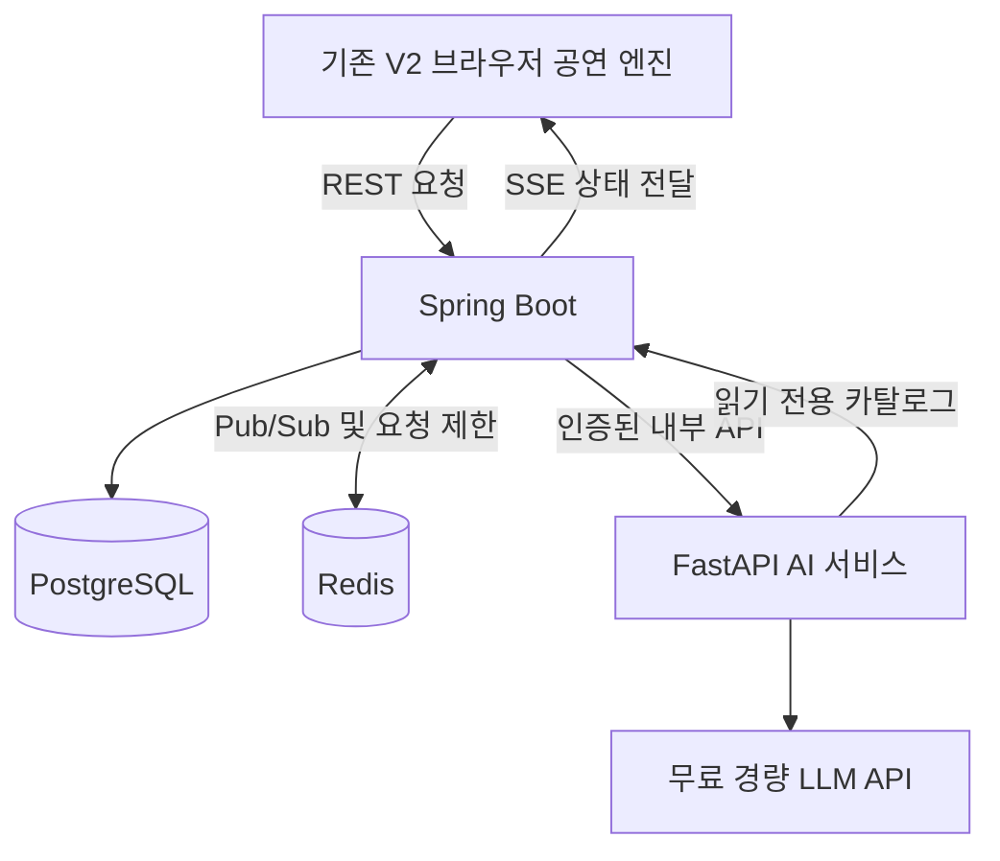
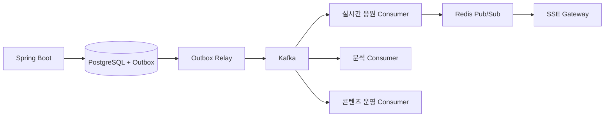

# 네 이름을 불러줄게! V3 — 최종 개발 기획서

- 기준일: 2026-11-29 | 상태: 개발 전 범위 확정안, 세부 설계 검증 전
- 연계: [PRD_V3.md](PRD_V3.md), [PLANNING_V2.md](PLANNING_V2.md), [PRD_V2.md](PRD_V2.md)
- 대상: https://github.com/MyungjuKim0524/call-your-name / https://call-your-name.vercel.app/
- 목표 기간: AI Agent 활용 2주~1개월. 4주 집중 개발을 목표로 하되 완료 보장 아님.
- 비용: 기존 AI Agent 구독료 외 추가 과금 0원. 무료 한도 내 낮은 비용의 경량 LLM API 사용.
- 목적: 실제 공개 서비스와 취업 포트폴리오 병행. 주력 백엔드, 2순위 AI 응용 서비스, 보조 DB·프롬프트 역량.

## 1. 개발 배경 및 방향

V1은 음악에서 영감을 받은 개인화 위로 비주얼 노벨, V2는 기존 세 고민의 인터랙티브 위로 스토리와 개인 오두막, 밤빛 해변의 병편지, 개인 별빛 콘서트로 확장하는 제품 고도화 단계다. V3는 별빛 콘서트를 중심으로 공동 감상·응원 및 AI 공연 연출이 가능한 콘텐츠 플랫폼으로 발전시킨다. V2 기획은 구현 완료를 뜻하지 않으며 Phase 0에서 실제 상태를 확인한다.

**서비스 정의:** 동물 친구들이 공연하는 별빛 콘서트를 함께 감상하고 응원하거나, 직접 또는 AI의 도움으로 나만의 무대를 구성해 공유하는 감성 콘텐츠 서비스.

- V2의 위로·휴식·자유 탐색, 캐릭터와 자체 작성 대사, 기본 환경음, 병편지 안전 정책을 유지한다.
- 사용자 경험의 중심은 음악과 공연을 즐기는 것. 점수·랭킹·강제 참여·유료 응원·공개 채팅은 도입하지 않는다.
- 기술 개수보다 동시성, 데이터 무결성, 실시간 복구, AI 출력 검증에 집중한다.
- 실제 이용 권리가 확인된 음원만 사용한다. K-pop 연동은 장기 조건부이며 현 개발에는 포함하지 않는다.

## 2. 핵심 기능 및 범위

P0: 4주 기준 핵심 출시 목표. P1: P0 안정화 후 기간 내 선택. P2: 승인된 방향이나 범위 축소에 따라 후순위 백로그; 이번 출시 완료 조건 아님. 제외: 개발하지 않음. 상세 인수 기준은 PRD의 동일 ID 참조.

| ID | 기능 | 우선순위 | 선정 근거 |
|---|---|---|---|
| V3-F01 | 공연 콘텐츠 카탈로그·버전·간소화 큐시트 | P0 | 공동 공연과 AI가 같은 자산·시간축을 사용 |
| V3-F02 | 공연 프리셋 저장·링크 공유 | P0 | 콘텐츠 재사용, 데이터 모델링, 권한 및 API |
| V3-F03 | 실시간 공동 콘서트 감상 | P0 | 시간 동기화, SSE, 재접속, 세션 수명주기 |
| V3-F04 | 공동 응원봉·게이지·특별 연출 | P0 | 트랜잭션, 멱등성, 동시성 및 이벤트 전달 |
| V3-F05 | AI 공연 연출 Agent | P0 | 자연어 → 실제 실행 가능한 큐시트, 도구 호출 및 평가 |
| V3-F06 | 최소 운영자 도구 | P0 | 콘텐츠 등록·검증·공개·공연 운영, 인증·인가 |
| V3-F07 | 한국어·영어 지원 | P1 | 글로벌 콘텐츠 경험, locale 및 번역 자원 관리 |
| V3-F08 | 시즌·컴백 이벤트 예약 공개 | P1 | 기존 콘텐츠의 시간 기반 운영; 별도 보상 없음 |
| V3-F09 | 최소 콘텐츠 이용 분석 | P1 | SQL 집계 기반 실제 서비스 이해 |
| V3-F10 | AI 현지화·번역 품질 검수 | P2 | 한·영 콘텐츠 운영 보조, 하나의 파이프라인 |
| V3-F11 | 선택적 회원가입·설정 동기화 | P2 | 익명 접근을 보존하며 필요 시 확장 |
| V3-F12 | 정기 배치 집계 | P2 | 집계 비용·재처리 요구가 확인된 경우 |
| V3-F13 | 보안·성능·테스트·CI/CD·배포 | P0 | 실제 개발 역량의 검증, 공개 서비스 보호 |
| V3-F14 | Kafka 미래 확장 기술 문서 | P0 (문서만) | 도입 판단·확장 설계 역량, 실제 사용과 구분 |
| V3-F15 | 무료 콘서트 입장권 예약·취소·입장 검증 | P0 | 한정 재고 동시성, 트랜잭션, 중복 및 초과 예약 방지 |

제외: 별도 실시간 등불, 방장 제어형 공연방, 범용 CMS, AI 음원 자동 분류, Kafka 설치·코딩·실험·배포, 실제 K-pop, 공연 영상 인코딩, 새로운 대규모 프론트 프레임워크 전환. AI 음원 분류는 기존 승인 후보였으나 축소안에 따라 제외 권고를 반영했다.

## 3. 핵심 이용 경험

### CORE 01 — 공동 콘서트 (F03~04)
- 오두막/개인 공연에서 공동 공연으로 선택 진입. 동일한 공개 공연을 여러 방문자가 감상하고 응원 효과를 공유하는 B안.
- 공연 시작·종료는 서버의 기준 시각과 게시된 큐시트 버전으로 결정한다. 참가·재접속 때 현재 위치를 계산하고 사용자가 재생을 시작하도록 한다. 음악 파일은 각 브라우저에서 재생하며 서버에서 오디오를 실시간 중계하지 않는다.
- 응원 요청은 REST, 상태 전파는 SSE. 공동 게이지는 DB에 확정된 카운트만 반영하고, 목표 달성 시 특별 조명·별빛 등 시각 효과를 한 번의 논리 이벤트로 발생시킨다.
- 재접속 시 최신 상태를 복구한다. 접속 끊김·음원 로딩 실패 시 표시하고 개인 공연 또는 오두막으로 돌아갈 수 있다.
- 응원봉 흔들기 표현은 클라이언트에서 처리하며 센서 권한·채팅·사용자 목록 노출을 요구하지 않는다.

### CORE 01-A — 무료 티켓팅 (F15, P0)
- 자유 관람 공연과 별도로 정원 제한 예약 공연을 지원한다. 예약은 무료이며 결제·좌석 선택·대기열·양도·재판매는 제외한다. 기존 개인 공연과 자유 관람 경로는 항상 유지한다.
- 운영자가 공연 일정, 예약 기간, 정원을 등록한다. 익명 서버 세션으로 예약·취소·입장 자격을 검증한다. 개인정보나 일반 회원가입을 요구하지 않는다.
- 공연별 활성 예약은 익명 주체당 최대 하나(설계 기준안). PostgreSQL 트랜잭션 안에서 공연 재고 행 잠금 또는 조건부 원자 갱신과 예약 기록을 함께 처리한다. Redis는 요청 제한에만 사용하며 입장권 재고의 원본이 아니다.
- 취소 시 정원 반환은 한 번만 수행한다. 재시도·예약/취소 경합·마감 및 입장 시각 경계·다중 서버 경합을 검증한다. 예약이 없거나 취소된 방문자는 예약 공연에 입장할 수 없다. 재접속은 유효 예약으로 복구한다.
- 예약 취소 허용 시간, 정원 및 정확한 성능 목표는 Phase 0에서 승인한다. 대규모 실제 트래픽을 처리했다고 주장하지 않는다.
- P0 추가에 따라 관리자 UI는 공연·자산 공개와 예약 일정/정원 관리만으로 제한하고, 분석·다국어·시즌·추가 AI 작업은 P0 완료 전 착수하지 않는다.

### CORE 02 — AI 콘서트 무대 연출 (F05)
- AI-04(연출 추천)와 AI-05(프리셋 생성 Agent)를 단일 기능으로 통합한다.
- 예: '몽환적인 밤바다 느낌으로 시작해서 축제 분위기로 마무리해 줘' → 공개 카탈로그 조회 → 등록된 음악·무대·캐릭터·조명·안무·효과로 구성한 큐시트 → 검증 → 미리보기·수정 → 저장/공유.
- Spring Boot가 제품 API와 최종 정책을 책임지고 FastAPI가 경량 LLM 호출·도구 실행·구조화 출력을 담당한다. 도구는 읽기 전용 카탈로그 조회로 제한한다. 자동 공개·임의 자산 생성·외부 실행은 금지한다.
- AI가 실패하거나 무료 한도가 소진되면 수동 편집/기본 프리셋으로 돌아간다. AI 없이도 공연을 즐길 수 있어야 한다.
- 프롬프트 버전, 도구 호출 성공, 스키마 유효성, 존재하는 자산 참조, 타임라인 제약, 사용자 의도 반영을 평가한다. 원문 입력은 기본적으로 저장하지 않고 고민·이름 등 개인 정보를 AI에 보내지 않는다.

### CORE 03 — 콘텐츠 관리 및 공유 (F01~02, F06)
- 음원·캐릭터·안무·무대·조명·효과의 안정적 ID, 이용 권리, 공개 여부, 버전을 관리한다.
- V2 음악 기반 엔진을 재사용하고 간단한 구간별 큐시트 편집기를 제공한다. 전문 편집기·영상 생성은 제외한다.
- 프리셋 공유는 링크를 아는 방문자가 공연 설정을 불러오는 방식. 개인 이름·고민·임의 자유 문구가 포함되지 않도록 한다. 공개 갤러리·검색은 제외한다.
- 최소 운영자 도구는 카탈로그·공연 버전 검증/공개와 일정 운영 중심. 기존 병편지 운영 기능을 유지하며 AI 결과의 운영자 자동 게시 기능은 제외한다.
- 익명 이용을 유지한다. 프리셋 수정·삭제는 서버 검증 가능한 소유 자격으로 보호하고 관리자 인증은 V2 구조를 재사용·검증한다. 일반 계정은 P2.

## 4. 기술 스택 및 대안 비교

| 기술 | 선택 이유 | 비교 대안 / 판단 |
|---|---|---|
| Java / Spring Boot, JPA, Security | 주력 서버, 트랜잭션·인가·API 통합 | FastAPI 단독도 가능하나 Java/Spring 역량 증명과 V2 연속성을 우선 |
| PostgreSQL / Flyway | FK·UNIQUE·트랜잭션, 버전 관리·SQL 집계 | 문서 DB보다 관계 제약 및 응원 정합성에 적합 |
| SSE + REST | 서버→브라우저 상태 전달, 응원은 검증 가능한 HTTP | WebSocket 양방향 지속 연결은 현재 B안에 불필요; polling은 복구 대안 |
| Redis Pub/Sub | 다중 서버 SSE 팬아웃 | JVM 로컬 이벤트는 단일 서버 기준선; Kafka는 현재 불필요 |
| Redis 요청 제한 | 다중 서버에서 제한 상태 공유 | 로컬 제한은 단일 서버에서만 유효; 장애 시 공개 쓰기 보호 |
| FastAPI + 무료 LLM API | Python AI 생태계, Spring의 제품 책임과 AI 책임 분리 | Spring 단독/로컬 모델도 가능하나 사용자가 분리 및 무료 API 선택 |
| Vanilla JS ES Modules, SVG, Canvas, Tone.js / Web Audio | V2 재사용, 오디오 시간 기준 연출 | React/Next.js 전면 전환은 비용 대비 주력 직무 효용 낮음; Vite/Vitest는 필요 시 채택 |
| JUnit, PostgreSQL/Redis 통합 테스트, pytest, Playwright, k6 | DB 실물 검증, AI 평가, UI 회귀, SSE/부하 측정 | 모의 DB만으로 동시성 검증하지 않음; 도구 호환성은 Phase 0 확인 |
| Docker, GitHub Actions | 재현성 및 CI/CD | 수동 배포만 하는 방식보다 반복 검증 가능; 무료 실행 한도 확인 |

DB 공급자: V2 문서에는 기존 Supabase 우선이 명시되어 있다. Neon은 추천 후보이며 이전 시점은 명시적 확정이 없으므로 **V3 착수 때 실제 V2 DB를 기준으로 유지**, 사용자 승인 시 Neon으로 이전한다. 보유 프로젝트 수만으로 가용 쿼터를 단정하지 않는다. 공식 가격표(https://supabase.com/pricing, https://neon.com/pricing)와 계정 대시보드 확인 후 결정한다. V2 문서는 이번 산출물에서 변경하지 않는다.

## 5. 목표 아키텍처

- PostgreSQL이 응원·게이지·공연 공개 버전의 원본이다. Redis 메시지는 알림용이며 영속 원본이 아니다.
- 응원 기록, 카운트 증가, 목표 달성 이벤트를 같은 DB 트랜잭션에서 처리한다. 커밋 후 이벤트 발행. 발행 실패나 재연결 시 최신 DB 스냅샷으로 복구한다. Pub/Sub 자체의 재전송/정확히 한 번 전달을 주장하지 않는다.
- 목표 달성의 논리 이벤트는 DB UNIQUE 등으로 한 번만 생성한다. 화면에서는 이벤트 ID/상태 버전으로 중복·역순 알림을 처리한다.
- 공개 배포는 단일 Spring 인스턴스여도 된다. 다중 인스턴스 팬아웃·장애 실험은 로컬 Docker에서 재현하며 운영 확장 실적으로 표현하지 않는다.
- 기존 V2 모듈·API·스키마를 먼저 점검하고 점진적으로 추가한다. 모든 기존 기능의 재작성은 금지한다. 예약 공연의 입장 검증은 REST와 SSE 모두 서버에서 수행하며 정원은 DB에서 관리한다.

## 6. 채용 역량과 증빙 계획

| 영역 | 기술 문제 | 증빙 |
|---|---|---|
| 백엔드 | 동시 요청 Lost Update, 멱등 처리, 목표 달성 중복 | 실패 재현, 트랜잭션/원자적 갱신 비교, 통합 테스트 |
| 티켓팅 | 한정 정원 초과, 중복 예약, 취소 경쟁 | 실제 PostgreSQL 동시 요청·롤백·인가 검증 |
| 실시간 플랫폼 | 다중 인스턴스 전달, SSE 끊김, 역순 메시지 | 동일 조건 로컬 비교, 연결 복구, 재생 오차 측정 |
| DB | 관계 모델, FK/UNIQUE, 인덱스·N+1 | ERD, 합성 데이터, EXPLAIN ANALYZE 전후 |
| AI | 가짜 자산, 범위 위반, 무료 API 실패 | 평가셋, 프롬프트 버전 비교, 검증 및 대체 동작 |
| 운영 | CI, 배포, 비밀 관리, 비용 제한 | 실행 가능한 Docker 구성, CI 결과, 구조화 로그·헬스체크 |

이 매핑은 직무 관련 역량에 대한 기획 판단이며 최신 채용공고 재조사나 합격률 추정은 수행하지 않았다. 실제 운영 지표와 로컬 합성 데이터 결과는 구분한다.

## 7. Phase별 실행 로드맵

| Phase | ID | 세부 Task | 완료 산출물 | 집중 작업일 추정 |
|---|---|---|---|---|
| 0 | F13 | V2 회귀 기준선, 자산 권리, DB/무료 호스팅·SSE·LLM 한도, 위험·목표 수치 승인 | CURRENT_STATE, 기준선, ADR | 1~2 |
| 1 | F01,F02,F06 | ERD/Flyway, 카탈로그 API, 버전·프리셋, 최소 편집/관리 UI, 권한 테스트 | ERD, OpenAPI, 큐시트 스키마 | 4~5 |
| 2 | F03,F04,F15 | 무료 예약·취소·입장 검증, 서버 시간 동기화, SSE, 응원 트랜잭션, Redis, 재접속, 장애 테스트 | 시퀀스, 동시성 테스트 | 7~10 |
| 3 | F05 | FastAPI, 읽기 전용 도구, 검증·미리보기, 평가셋 및 실패 대응 | 프롬프트/평가 보고서 | 4~6 |
| 4 | F13,F14 | 보안·회귀·부하·인덱스 비교, Kafka 미래 설계 문서 | 테스트·벤치마크·ADR | 3~5 |
| 5 | F13 | CI/CD, 무료 배포 검증, 운영 체크리스트, 포트폴리오 문서 | 배포/README/시연 | 2~3 |
| 6 | F07~09 | P0 통과 이후 한·영, 시즌 공개, 최소 SQL 분석 | 개별 인수 테스트 | 잔여 기간 내 |

P0 총 21~31 집중 작업일 추정으로 낙관적이다. 2주라면 F01~04 및 F15 중심 로컬 MVP를 우선하고 F05 및 고급 Redis 실험의 완료 일정을 조정한다. 3~4주에는 AI·다중 서버 검증까지 목표로 한다. 보안·데이터 무결성·권리·공개 출시 게이트는 기간을 이유로 생략하지 않는다. 미완료 기능은 비활성화하며 V3 전체 완성으로 발표하지 않는다.

## 8. Kafka 향후 확장 (F14, 설계 전용)

### 도입 보류 및 재평가 조건
현재 공연 응원 원본은 PostgreSQL에 있으며 Redis/SSE는 순간 상태를 전달한다. 영속 이벤트 재처리, 서로 독립적인 소비자의 증가, 기존 DB/이벤트 전달 구조의 측정된 병목, 장시간 장애 후 이벤트 복구 요구가 생길 때 Kafka를 재검토한다. 실제 처리량과 운영 비용을 측정하여 기준을 정하며 임의의 트래픽 수치를 도입 근거로 만들지 않는다.

### 목표 구조

- DB 갱신과 Outbox 행 삽입을 동일 트랜잭션으로 처리. relay가 커밋된 행을 발행하고 성공 확인 뒤 처리 상태를 기록한다. 폴링 relay와 CDC(Debezium 등)는 비용·운영 복잡도·지연으로 비교한다.
- 예시 Topic: `concert.cheer.v1`, `concert.milestone.v1`, `content.published.v1`, `analytics.interaction.v1`. 확장 시 AI 비동기 요청/결과 topic은 별도 검토한다.
- 공연 이벤트의 key는 `concert_id`, 콘텐츠 이벤트는 `content_id`; 동일 partition 내 순서만 보장된다. 공연 하나에 트래픽이 몰리는 hot partition과 재파티셔닝 영향도 평가한다.
- 이벤트 envelope 후보: `event_id`, `event_type`, `schema_version`, `aggregate_id`, `aggregate_version`, `occurred_at`, `payload`. 이름·고민·AI 입력 원문은 제외한다.
- 최소 한 번 전달을 전제로 소비자별 event_id UNIQUE/처리 기록 및 상태 버전 비교. offset commit은 처리 성공 후, 외부 부작용은 별도 멱등성 설계. Kafka 설정만으로 DB까지 exactly-once가 보장되지 않는다.
- 독립 Consumer Group으로 실시간 전파·통계·콘텐츠 후처리를 분리. transient 오류 재시도, 영구 오류 격리/DLQ, 순서 훼손 가능성, 재처리 승인과 보존·삭제 정책을 설계한다. consumer lag, publish 오류, outbox 적체, 중복률, end-to-end 지연을 관측 대상으로 둔다.
- Redis는 팬아웃/캐싱/제한에 유지하고 SSE는 브라우저 연결 역할을 유지한다. Kafka로 모든 응원 요청을 직접 옮겨 정합성을 약화시키지 않는다.
- 전환 계획: 현재 이벤트 계약 문서화 → 별도 환경에서 Outbox/relay 검증 → 비사용자 영향 shadow consumer → 결과 대조 → 기능 플래그로 소비 경로 전환 → 롤백 시 기존 Redis 경로 유지. 전환 중 중복 발행은 같은 논리 이벤트 ID로 제거한다.
- 대안: Redis Streams(소규모 영속 이벤트·consumer group), RabbitMQ(작업 큐·라우팅), Kafka(보존 로그·다중 독립 소비·재처리). 실제 도입 시 요구사항과 비용을 다시 비교한다.

산출물: `docs/design/FUTURE_KAFKA_ARCHITECTURE.md`에 위 설계를 상세화, `DECISIONS.md`에 도입 보류 ADR, `tasks/backlog.md`에 향후 후보 등록. V3에서는 문서만 작성하며 Kafka 설치, 의존성, Topic 실제 생성, 코드, 배포, 부하 테스트를 금지한다. 향후 검증 계획은 처리량·재처리·장애·유실·중복·비용을 비교하되 현재 실적으로 표기하지 않는다.

## 9. 변경 통제 및 미확정 사항

- 이번 문서는 사용자의 축소 방향 승인에 따른 목표 범위다. 다국어·시즌은 후순위로 이동했고 AI 현지화/검수는 통합 P2, 음원 분류는 제외했다.
- 미확정: 예약 정책 세부 시각·정원, DB 이전 시점, 정확한 무료 호스팅/Redis/LLM 공급자와 모델 ID, V2 실구현 상태, 자산 목록·권리, 운영자 인증 방식 재사용 가능성, 보존 기간, 실제 성능 목표/부하 규모. Phase 0에 확인·승인하고 임의 확정하지 않는다.
- 문서 관리: AGENTS → CURRENT_STATE → tasks/active 순으로 읽고 PRD/설계/ADR을 선택 참조. 기능 ID 변경은 기획서와 PRD를 함께 갱신한다. 완료 작업은 archive/v3에 보관한다.
- V2 및 기존 저장소를 이번에 수정하거나 배포하지 않았다. 출처는 V2 최종 기획서·PRD와 이후 사용자 합의이며 새 저장소 감사·현재 무료 플랜 재검증은 수행하지 않았다.
