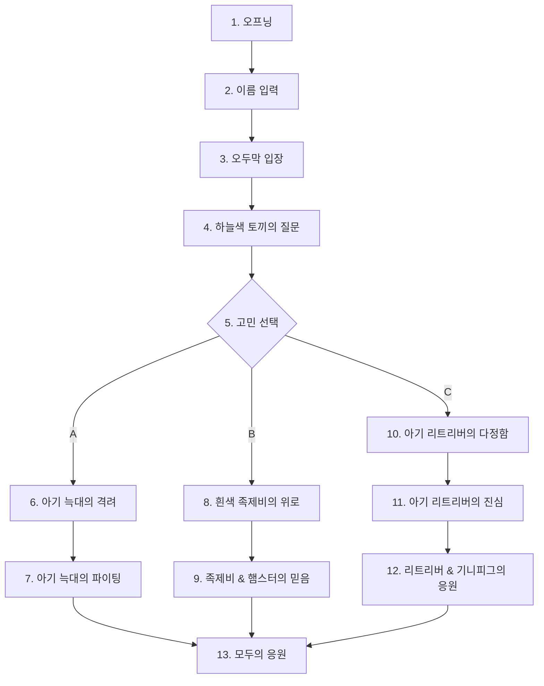

# 스토리보드

손으로 그린 13개 장면 콘티와 실제 구현을 장면 단위로 대조한 문서입니다.

- 원본 콘티: [1~10번 장면](./assets/handwritten/storyboard-scenes-01-10.jpg) · [11~13번 장면](./assets/handwritten/storyboard-scenes-11-13.jpg)
- 캐릭터 번호는 [캐릭터 정의서](./characters.md)를 따릅니다.

---

## 1. 장면 흐름

## 2. 공통 배경

콘티 메모: **“모닥불 난로가 있는 노란 조명의 따뜻한 방. 오두막 느낌!”**

3번부터 13번 장면까지 같은 오두막 배경을 공유합니다.

---

## 3. 장면별 콘티와 구현

| # | 콘티 | 구현 | 코드 |
| --- | --- | --- | --- |
| 1 | 제목 “네 이름을 불러줄게!” | 제목 카드에 부제 `24/7 WITH YOU`, 캐릭터 이모지, 소개 문구 “지친 하루 끝, 너만을 기다리는 작은 오두막 이야기” 추가 | `#screen1` |
| 2 | 편지 봉투 아이콘이 달린 “NEW! 당신의 이름을 입력해주세요” 입력창 | 콘티 그대로 구현 | `#screen2`, `submitName()` |
| 3 | 캐릭터 2·4·5 / 6·3·1이 모여 있음. 메모: “캐릭터들이 자기들끼리 떠들며 놀고 있다가, 문이 열리는 연출에 나(화면)를 쳐다본다. 시점은 1인칭으로, 한숨을 쉰 뒤 방문을 여는 나의 손부터 보여준다.” | 1인칭 한숨 대사 “후우...... 오늘도 정말 수고 많았어.” → 문이 양쪽으로 열림 → “모두 일제히 (이름) 쪽을 바라봤다!” → “앗! 문이 열렸다—! (이름)!! 어서 와, 기다리고 있었어!” 배치 순서는 콘티와 같음 | `startScene3DoorIntro()` |
| 4 | 캐릭터 1: “(이름), 무슨 고민있어?” | 콘티 그대로 구현 | `SCENARIO_GRAPH["4"]` |
| 5 | 고민 선택지 A·B·C | 콘티의 세 문장을 그대로 선택지로 구현 | `selectChoice()` |
| 6 | (A 선택) 캐릭터 3: “(이름)! 기 죽지마! 연습하면 다 돼 진짜아” | 콘티 그대로 구현 | `SCENARIO_GRAPH["6"]` |
| 7 | 캐릭터 3이 주먹을 쥔 모습: “조금만 더 해보자! 내가 응원할게” | 주먹 포즈(`showFist`)와 함께 구현 | `SCENARIO_GRAPH["7"]` |
| 8 | (B 선택) 캐릭터 5: “(이름)! (이름)은 우리의 꿈이고 희망인걸......” | 조사를 “(은)는”으로 표기해 구현 | `SCENARIO_GRAPH["8"]` |
| 9 | 캐릭터 5·6: “자존감 낮아지지마 (이름)! / 그리고 불안할 때면 (이름)을 믿는 우리를 믿어요!” | 두 캐릭터를 나란히 배치해 구현 | `SCENARIO_GRAPH["9"]` |
| 10 | (C 선택) 캐릭터 4: “(이름)! 괜찮아 굳이 행복하지 않아도 돼요” | 콘티 그대로 구현 | `SCENARIO_GRAPH["10"]` |
| 11 | 캐릭터 4: “그냥 나를 보며 하루에 조금씩이라도 웃을 수 있으면 좋겠어” | 콘티 그대로 구현 | `SCENARIO_GRAPH["11"]` |
| 12 | 캐릭터 4가 캐릭터 2에게 붙어 있음: “사랑해예! ♡ / (이름) 사랑해예, 힘내예 다 괜찮아예!” | 캐릭터 4가 2에게 달라붙는 배치(`char-cling`)로 구현 | `SCENARIO_GRAPH["12"]` |
| 13 | 캐릭터 6·1·3·5·4·2가 한 줄로: “(이름), 사랑해! 오늘도 힘내자 우리!!” | 콘티와 같은 순서로 배치. 응원 포토카드 저장, 별빛 방명록 버튼 추가 | `goToScene13Ending()` |

## 4. 콘티에서 달라진 점

| 장면 | 변경 | 이유 |
| --- | --- | --- |
| 1 | 부제와 소개 문구 추가 | 게임 제목과 이어지는 문구로 첫인상을 보강 |
| 3 | “나의 손” 대신 한숨 대사와 문이 열리는 연출로 표현 | ⚠️ 확인 필요 |
| 8, 9 | 이름 뒤 조사를 “(은)는”, “(을)를”로 표기 | 입력된 이름의 받침 유무에 따라 조사가 달라지므로 |
| 13 | 포토카드 저장, 방명록 버튼 추가 | 개발 중 기능 범위를 검토하며 추가로 채택 ([의사결정 기록](./ai-collaboration.md#4-ai-제안에-대한-의사결정)) |
